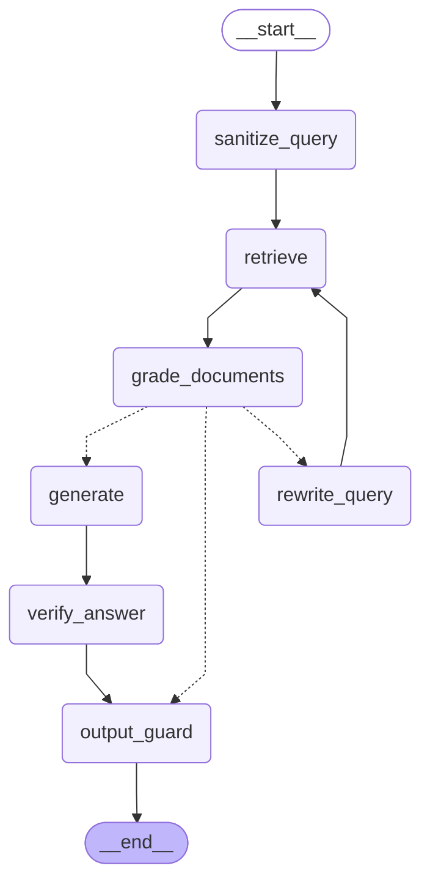

# Corrective-RAG Agent State Graph — VeilRAG

> Automatically generated from the compiled LangGraph state graph object (`src/rag/agent.py`).

## Architecture & State Transitions

1. **`sanitize_query`**:
   - Redacts PII from user query with `mode=PIPELINE_MODE` and `placeholder_prefix="Q_"`.
   - Prevents collision with chunk-level placeholders in the vector store.
   - Extracts request-scoped reversible map for optional query-only value revelation.
2. **`retrieve`**:
   - Embeds sanitized query using local `sentence-transformers` model.
   - Retrieves top-k candidate chunks from ChromaDB cosine vector store.
3. **`grade_documents`**:
   - Evaluates relevance of each candidate chunk (yes/no binary classification).
   - Routes to `generate` if >= 2 relevant chunks or after max 2 query rewrites.
   - Otherwise routes to `rewrite_query`.
4. **`rewrite_query`**:
   - Rephrases query to improve retrieval quality.
   - Sanitizes rewritten query with `PIPELINE_MODE` and loops back to `retrieve`.
5. **`generate`**:
   - Prompts the LLM adapter to answer strictly from the context, requiring citations for all claims.
   - Defaults to 'I don't know' if insufficient context exists.
6. **`verify_answer`**:
   - Hallucination and groundedness check: ensures every claim is supported by retrieved chunks.
   - Regenerates once if unsupported; falls back to 'I don't know' if second check fails.
7. **`output_guard`**:
   - Final line of defense: sanitizes LLM response with `PIPELINE_MODE` before presentation.
   - Emits structured telemetry (duration, tokens, cost, entity types/counts only, never raw PII).
